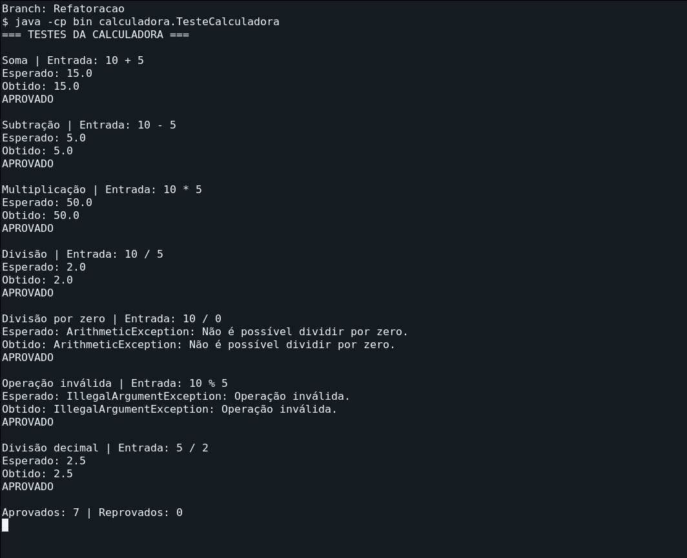
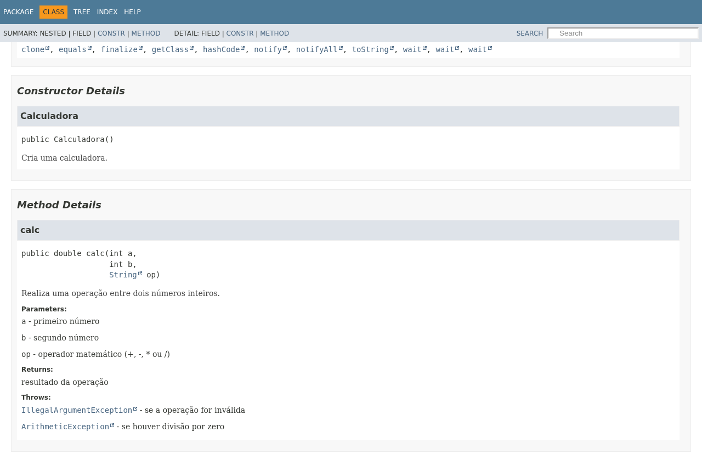

# Projeto Calculadora – FinançApp

## Descrição

Calculadora em Java criada para uma atividade de qualidade de software. A classe `Calculadora` recebe dois números inteiros e um operador e devolve um resultado do tipo `double`. O programa `Main` permite usar a calculadora pelo terminal e exibe mensagens de erro sem encerrar o menu.

## Objetivo

Praticar operações matemáticas, testes unitários e funcionais, tratamento de erros, refatoração, documentação JavaDoc e versionamento com Git.

## Tecnologias utilizadas

- Java (JDK 21 utilizado na validação; código compatível com Java 8 ou superior).
- JavaDoc para gerar a documentação HTML.
- Git e GitHub para versionamento e publicação.
- Testes unitários com Java puro, sem JUnit ou dependências externas.

## Operações

| Operação | Operador | Entrada de exemplo | Resultado |
| --- | --- | --- | --- |
| Soma | `+` | 10 + 5 | 15.0 |
| Subtração | `-` | 10 - 5 | 5.0 |
| Multiplicação | `*` | 10 * 5 | 50.0 |
| Divisão | `/` | 10 / 5 | 2.0 |
| Divisão decimal | `/` | 5 / 2 | 2.5 |

A divisão por zero gera `ArithmeticException` e operadores desconhecidos geram `IllegalArgumentException`. O programa principal captura essas exceções e mostra a mensagem correspondente, permitindo continuar. Também trata números digitados em formato inválido.

## Como executar

Na pasta principal do projeto, usando um terminal com o JDK instalado:

```bash
mkdir bin
javac -encoding UTF-8 -d bin src/calculadora/*.java
java -cp bin calculadora.Main
```

Se a pasta `bin` já existir, não é necessário criá-la novamente. Digite `sair` para encerrar. No Windows PowerShell, caso o terminal não expanda `*.java`, informe os três arquivos Java explicitamente ao `javac`.

## Testes unitários

```bash
java -cp bin calculadora.TesteCalculadora
```

Os testes comparam automaticamente a entrada, o resultado esperado e o resultado obtido. Nos casos de erro, comparam o tipo da exceção e sua mensagem. Caso algum teste falhe, a execução dos testes termina com `AssertionError`. Os sete casos são soma, subtração, multiplicação, divisão, divisão por zero, operação inválida e divisão decimal.

Resultado da execução nesta branch: **7 aprovados e 0 reprovados**.



Também foi realizado um teste funcional do menu: soma, divisão por zero, operação inválida, número inválido e multiplicação após os erros. O programa continuou até o comando `sair`.

## Documentação JavaDoc

Abra [docs/index.html](docs/index.html) no navegador (ou abra o arquivo diretamente após clonar o projeto). A documentação contém classes, métodos, atributos, parâmetros, retornos e exceções, quando aplicáveis.

Para gerar novamente:

```bash
javadoc -private -encoding UTF-8 -docencoding UTF-8 -charset UTF-8 -d docs -sourcepath src -author -version calculadora
```




## Branches

- `main`: primeira implementação com `if` e `else if`.
- `Refatoracao`: uso de `switch` e extração de métodos para as operações matemáticas, mantendo a assinatura de `calc` e os mesmos resultados e mensagens de erro.

Para comparar as versões:

```bash
git diff main Refatoracao -- src/calculadora/Calculadora.java
```

Para mudar de branch:

```bash
git switch Refatoracao
```

## Link do repositório

Pendente de publicação: substitua esta linha pelo link real do repositório GitHub após o envio das duas branches.
